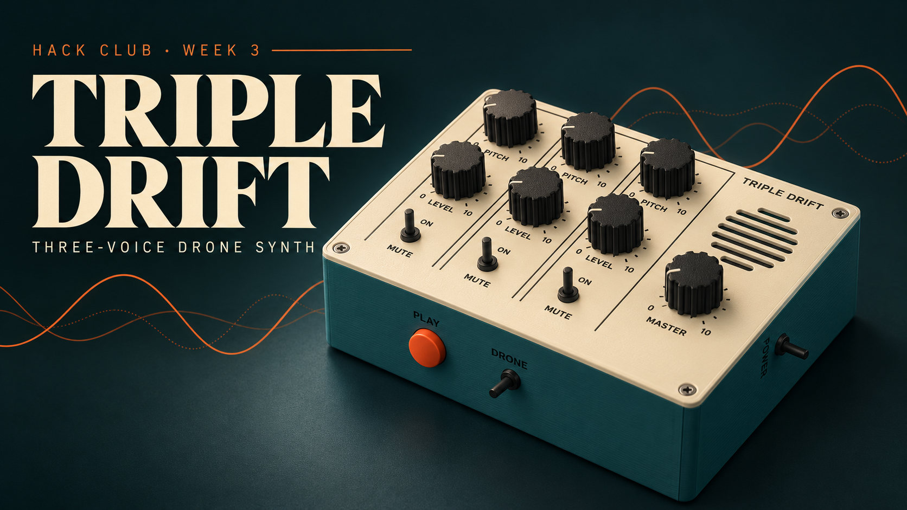
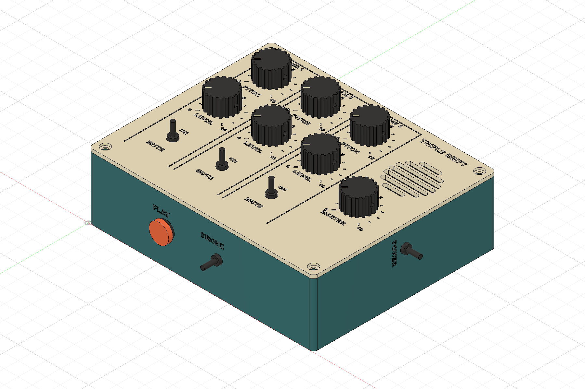

# Triple Drift Synth

Triple Drift is a small, standalone drone synthesizer designed for Hack Club’s Week 3 music challenge: circuits that turn voltage into sound. It combines three independently adjustable voices inside a custom 3D-printed enclosure.

## How it works

Each voice is a 555 timer circuit that outputs a repeating electrical signal. You hear a different note because the frequency of the oscillation is changed by the pitch knob. Each voice also has a level control and mute switch.

The three signals feed a mixer, master volume control and amplifier that drives a built-in speaker. The voices are closely tuned together. This creates slow beating and pulsing sounds. There is also a momentary PLAY button and a continuous DRONE mode to the instrument.

## Why I made it

I wanted to see how basic electronic components could make an instrument without a computer or pre-recorded sounds. This project is a combination of circuit design, PCB layout and mechanical CAD with a goal of a total budget of $65 including fabrication and shipping.

## Design

The PCB was designed in KiCad, the enclosure was designed in Autodesk Fusion. The enclosure has labeled controls, PCB mounting posts, a battery cradle, internal wire clips and a speaker grille.

## Current status

PCB and enclosure design is finished. The enclosure has been checked for digital interference and the exported print meshes have been checked. Physical assembly, sound testing and final hardware fit are still to come. The full $65 budget has not yet been confirmed.

This is an analog instrument, so it does not require firmware.
